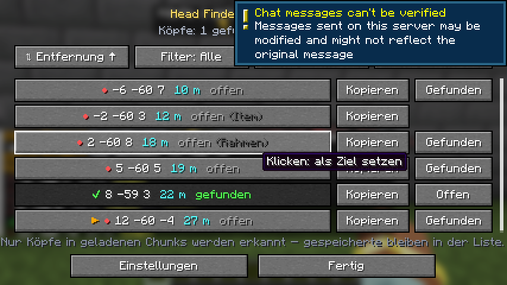
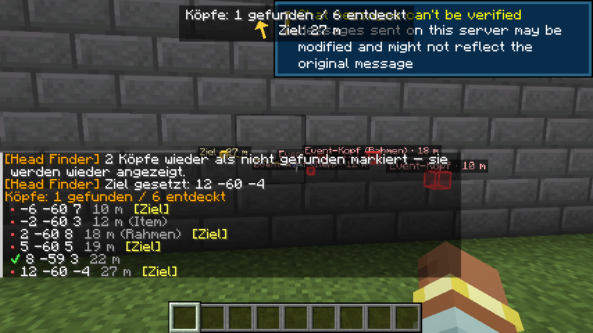
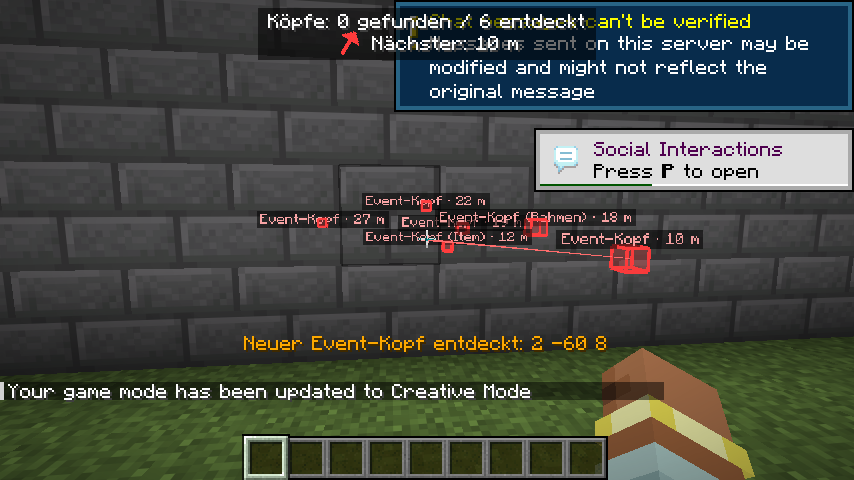
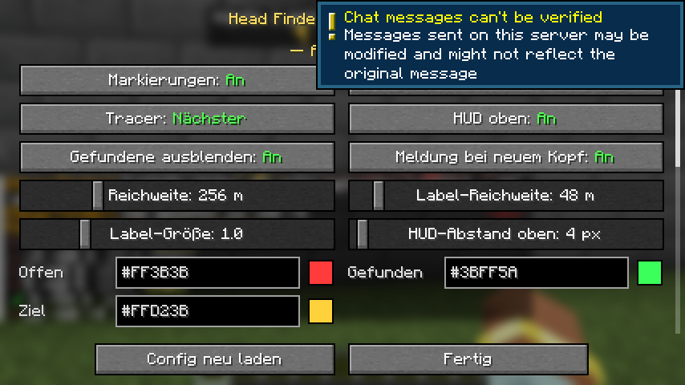

# Head Finder

    

**Minecraft 1.21.11 · Fabric · Java 21 · nur Client** · von **redstone_nugget**

Hilft dir beim Event-Köpfe-Suchen auf **Hugo SMP**: Erkennt die Event-Köpfe in geladenen Chunks, zeigt ihre
Koordinaten in einer Liste, markiert sie und führt dich per Pfeil hin. Gefundene Köpfe werden abgehakt
(Rechtsklick) und danach nicht mehr angezeigt. Der Fortschritt wird pro Server gespeichert.

<p align="center">
  
  
</p>
<p align="center">
  
  
</p>

> **Inoffiziell.** Nicht von Hugo SMP. Die Mod ist rein clientseitig, sendet keine eigenen Pakete und nutzt
> nur Daten, die dein Client sowieso vom Server bekommt. Prüf trotzdem selbst die Regeln des Servers.

## Download

[**GitHub Releases**](https://github.com/RedstoneNugget/Head-Finder/releases)

## Installation

1. [Fabric Loader](https://fabricmc.net/use/) (≥ 0.19) für Minecraft 1.21.11 installieren.
2. [Fabric API](https://modrinth.com/mod/fabric-api) in den `mods`-Ordner legen.
3. `head-finder-1.0.1.jar` in den `mods`-Ordner legen.
4. Optional: [Mod Menu](https://modrinth.com/mod/modmenu), dann sind die Einstellungen auch über die Mod-Liste erreichbar.

## Bedienung

| Taste / Aktion | Funktion |
|---|---|
| **K** | Liste aller entdeckten Köpfe: Koordinaten, Entfernung, gefunden ja/nein. Klick auf einen Eintrag = Ziel setzen, „Kopieren“ = Koordinaten in die Zwischenablage |
| **Rechtsklick** auf einen Kopf | Als gefunden markieren, danach wird er nicht mehr angezeigt |
| *(frei belegbar)* | Markierungen an/aus, Einstellungen öffnen |

Oben am Bildschirm: **„Köpfe: X gefunden / Y entdeckt“**, darunter ein Pfeil mit Entfernung (und ▲/▼ für die
Höhe) zum nächsten offenen Kopf bzw. zum gewählten Ziel.

Ein Kopf gilt außerdem als gefunden, wenn er verschwindet (Block weg, während sein Chunk geladen ist).
Köpfe außerhalb der geladenen Chunks können nicht erkannt werden. Einmal entdeckte Köpfe bleiben aber
gespeichert und in der Liste, auch wenn du weit weg bist.

### Befehle

| Befehl | Funktion |
|---|---|
| `/headfinder list [anzahl]` | Nächste Köpfe im Chat (Koordinaten anklicken = kopieren) |
| `/headfinder reset` | Alle wieder als **nicht gefunden** markieren (Positionen bleiben) |
| `/headfinder reset all` | Alles vergessen, auch die Positionen |
| `/headfinder toggle [markierungen\|tracer\|hud\|labels\|hidefound]` | Anzeige umschalten |
| `/headfinder target nearest\|clear\|<x y z>` | Ziel für Linie und Pfeil |
| `/headfinder found <x y z>` / `unfound <x y z>` | Status von Hand setzen |
| `/headfinder status`, `scan`, `reload`, `open` | Infos, neu scannen, Config neu laden, Liste öffnen |

Kurzform: `/hf …`. Die Befehle laufen nur im Client und werden nie an den Server geschickt.

## Erkennung

Gesucht werden Spielerköpfe (`player_head` / `player_wall_head`, als Item am Boden oder im Item-Frame)
mit diesem Profil:

- Name `FindEventHead` **oder**
- Textur `http://textures.minecraft.net/texture/3d8c1f399f9a74ce148300cb6fa79fbc13ba44f9a52c25ce9e452b49f5b40a10`

Die Profil-UUID ist bei jedem Event-Kopf anders und wird deshalb standardmäßig **nicht** verglichen; jeder
Kopf wird über Dimension + Blockposition identifiziert. Weitere Suchprofile (Name, Textur, optional UUIDs)
lassen sich in den Einstellungen oder in `config/head_finder/config.json` eintragen.

Gescannt werden nur die Block-Entities der Chunks (beim Laden und einmal pro Sekunde), nicht jeder Block.
Getestet mit 200 Köpfen: Anzeige ca. 0,04 ms pro Bild, Scan unter 0,5 ms pro Sekunde.

## Einstellungen

Markierungen (auch hinter Blöcken sichtbar), Labels, Linie zum Kopf (aus / nächster / alle), HUD und dessen Abstand oben, gefundene ausblenden
oder grün anzeigen, Farben (offen, gefunden, Ziel), Reichweite für Boxen und Labels, Label-Größe,
Rechts-/Linksklick bzw. Verschwinden = gefunden, Items & Rahmen erkennen, UUID-Vergleich, Scan-Intervall
und die Suchprofile.

Dateien:
- `config/head_finder/config.json` – Einstellungen
- `config/head_finder/found/<server>.json` – entdeckte und gefundene Köpfe pro Server (Dimension pro Eintrag)

## Selbst bauen

```bash
./gradlew build
```

Die fertige Datei liegt in `build/libs/`. Automatischer In-Game-Test (startet einen echten Client und
Server, prüft u. a. 200 Köpfe): `./gradlew runClientGameTest`

## Lizenz

[MIT](LICENSE) · redstone_nugget
